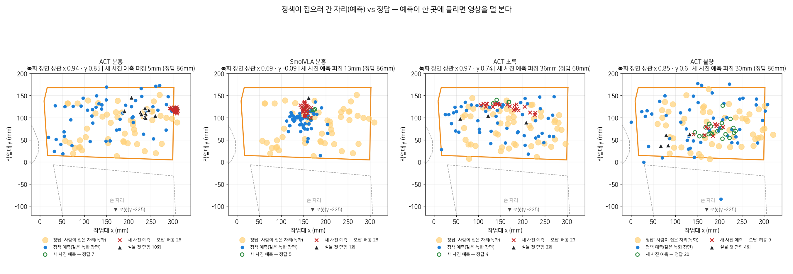
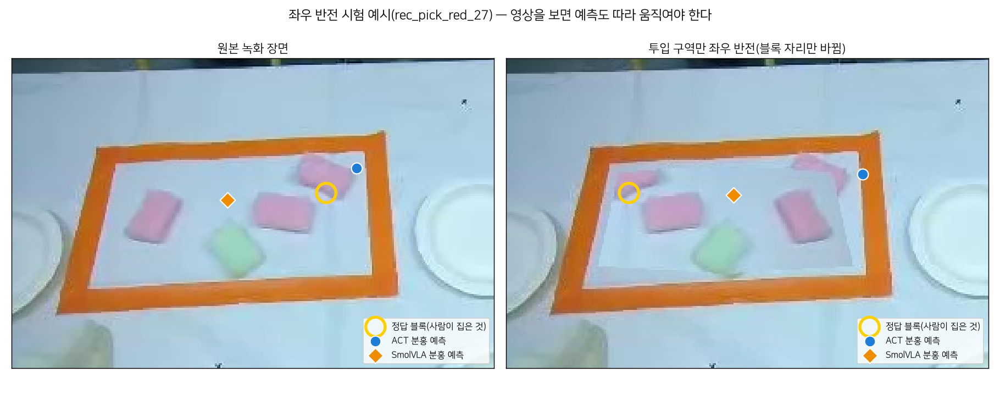
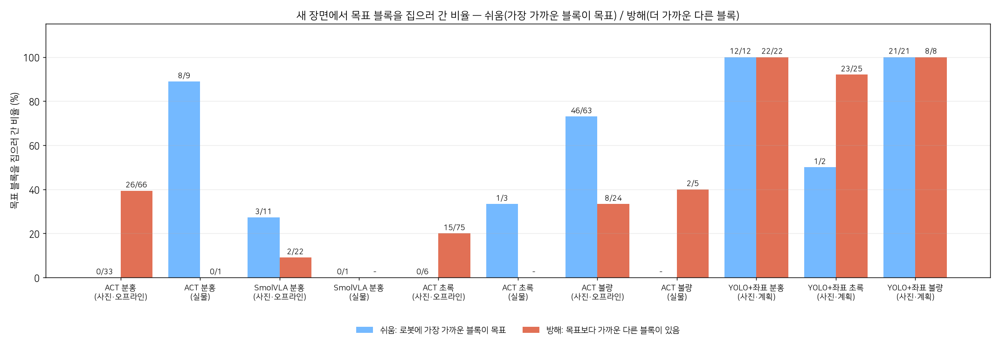
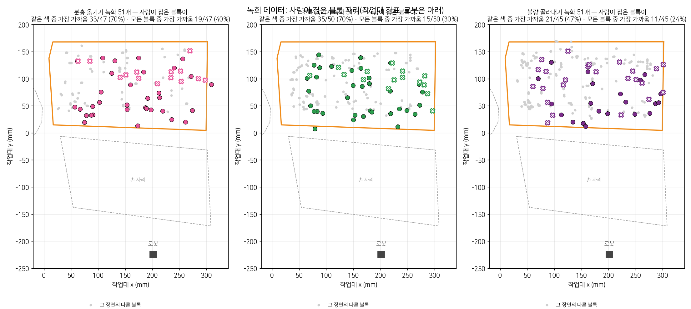

# 모방학습(ACT·SmolVLA) vs 모듈형(YOLO + 좌표 집기) — 오프라인 비교 (2026-10-22 밤)

> 로봇·카메라 없이 녹화·사진·실행 기록만으로 했다. 실제 로봇 송신은 0회였다.
> - 정책 추론: Studio 컨테이너 OpenVINO, CPU
> - YOLO: NPU
> - 좌표 계획: dry-run
>
> 재현은 맨 아래 명령으로 한다. 모든 숫자 = `robot/logs/n2/results.json`.

## 한 줄 결론

녹화 50개로 배운 정책은 **블록이 어디 있는지 보고 가지 않는다.** 위 사진의 주변(그릇에 이미 옮긴 블록·팔·배경)과 손목 사진으로 '어느 녹화 장면인가'를 알아보고, 그 에피소드에서 사람이 집은 자리를 재생한다. 처음 보는 장면에서는 블록 배치와 상관없이 한두 자리로 몰린다.

YOLO + 좌표 집기는 처음 보는 녹화 사진 142장(사람이 집은 블록을 알 수 있는 것)에서 목표 색 블록을 141번 골랐다. 좌표 계획은 분홍 98%·불량 92%·초록 75% 가 통과했다. 초록 실패는 금지 구역 설정 문제다.

## 1. 정책은 영상(블록 자리)을 보고 움직이나

| 정책 | 새 사진(known4·front) 예측 퍼짐 / 정답 퍼짐 | 예측↔정답 상관 r (x · y) | 블록만 좌우 반전: 예측 이동 기울기 (녹화 · 사진) | 블록만 짝 장면 것으로 바꿈: 블록 쪽을 따름 | 블록이 없어도 작업대 높이로 내려감 (블록 지움 · 빈 작업대) | 판정 |
|---|---|---|---|---|---|---|
| **ACT 분홍** | **5mm / 86mm** | **0.09 · 0.34** | **0.05 · 0.00** | 7/38 (주변 쪽 31) | 44/51 · 45/51 | **영상 사용 없음**. 손목 사진·주변으로 외운 장면을 재생 |
| ACT 초록 | 36mm / 68mm | 0.51 · 0.59 | 0.13 · 0.16 | 34/46 | 39/51 · 49/51 | 약함. 외운 블록 배치는 통째로 알아보지만 처음 보는 배치(반전)에선 초록을 못 따라감 |
| ACT 불량 | 30mm / 86mm | 0.67 · 0.72 | 0.10 · 0.15 | 15/44 (주변 쪽 29) | 16/51 · 28/51 | 약함. 새 사진에선 로봇에 가장 가까운 블록으로 51/87(59%) |
| SmolVLA 분홍 | 13mm / 86mm | −0.32 · −0.28 | 0.02 · 0.00 | (시간상 생략) | 8초 안에 안 내려감(빈 작업대에서도 원래 예측과 38mm 같은 방향) | **영상 사용 없음**. 장면과 거의 무관하게 (150, 110)mm 쪽으로 감. 실물 17:43 에 닫은 자리 (161, 145)mm 와 같은 쪽 |

- 예측 퍼짐은 √(σx²+σy²) 이다.
  - 사진 장면의 손목 사진은 녹화 rec_pick_red_00 것으로 대신했다(아래 '손목 사진 대용').
- 같은 녹화 장면(학습한 장면)에서는 모두 정답을 잘 따른다. 상관 r(x · y)과 사람이 집은 자리와의 거리 중앙은 다음과 같다.
  - ACT 분홍: r 0.94 · 0.85, 40mm
  - ACT 초록: r 0.97 · 0.74, 33mm
  - ACT 불량: r 0.85 · 0.60, 46mm
  - SmolVLA: r 0.69 · −0.09, 70mm(외운 정도도 ACT 보다 약함)

  그런데 블록만 바꾸면 따라가지 않는다. 즉 **외운 것이지 본 것이 아니다**.
- **손목 사진 대용이 결정을 정한다(ACT 분홍).**
  - 새 사진 33장에 rec_pick_red_00 의 손목 사진을 넣으면, 예측이 모두 그 에피소드에서 사람이 집은 자리 29mm 안의 한 점(퍼짐 7mm)에 모였다.
  - 다른 에피소드의 손목 사진을 넣으면 다른 한 점(퍼짐 22~24mm)에 모였다.
  - 같은 사진에서 손목 사진만 바꿔도 고른 블록이 33장 중 15장에서 달라졌다.
  - 홈 자세의 손목 카메라는 블록이 아니라 교실(사람·모니터)을 비춘다.
- 교실 배경(작업대 너머)만 짝 장면 것으로 바꾸면 예측은 거의 그대로였다(ACT 분홍 36/38 이 원래 장면 쪽). 배경보다 작업대 위 주변(그릇 안 블록 수·팔)이 단서다.
- 학습에서 뺀 10% 에피소드는 알 수 없었다. 그래서 검증은 '처음 보는 장면'으로 했다(방법 절).





반전은 사진마다 찾은 테이프 안쪽만, 가장자리 7px 띠를 빼고 뒤집는다. 그래서 테이프에 붙은 블록은 일부가 남을 수 있다. 블록 지움은 테이프 안쪽 식탁보 색(Lab 중앙값)에서 벗어난 부분을 둘레 식탁보 평균으로 채운다. 합성 사진은 `robot/logs/n2/scenes/*_mirror.jpg`·`*_empty.jpg`.

## 2. 위치 쏠림 — 목표를 고르나

**실물 실행 기록**(오늘 ACT·SmolVLA 실행 중 직전 검출 사진이 있는 19회)의 실제 첫 닫힘 자리 → 그때 블록:

| 정책 | 실행 | 목표 블록으로 감 | 쉬움 | 방해 | 비고 |
|---|---|---|---|---|---|
| ACT 분홍 | 10 | 8 | 8/9 | 0/1 | 첫 닫힘 자리는 목표와 상관없이 (190~260, 100~145)mm, **퍼짐 22mm(블록 83mm)**. 그 근처(50~65mm)에 분홍이 있던 8회는 집었고(실물은 손목 카메라로 다시 집어 맞춤), **분홍이 왼쪽(x 60mm)인 2회는 실패**(17:37 초록으로·17:44 허공) |
| SmolVLA 분홍 | 1 | 0 | 0/1 | - | 17:43 분홍 왼쪽(x 59mm) → 105mm 떨어진 허공 |
| ACT 초록 | 3 | 1 | 1/3 | - | 16:46 분홍으로, 17:03 허공(높이 68mm 에서 닫음) |
| ACT 불량 | 5 | 2 | - | 2/5 | 불량이 왼쪽 아래(작업대 y 55~75mm)면 2/3, 위쪽(y 135~145mm)이면 0/2 |

**오프라인 새 사진**(known4 30 + front 4, 손목 대용 3종 × 장면):

| 방법 | 쉬움 | 방해 | 로봇에 가장 가까운 블록으로 | 허공 |
|---|---|---|---|---|
| ACT 분홍 | 0/33 | 26/66 | 7/99 | 42/99 |
| SmolVLA 분홍(손목 대용 1종) | 3/11 | 2/22 | 6/33 | 4/33 |
| ACT 초록 | 0/6 | 15/75 | 7/81 | 6/81 |
| ACT 불량 | 46/63 | 8/24 | 51/87 | 15/87 |
| YOLO + 좌표(고름 ∧ 계획 성공) | 분홍 12/12 · 초록 1/2 · 불량 21/21 | 분홍 22/22 · 초록 23/25 · 불량 8/8 | - | - |

- 쉬움 = 로봇에 가장 가까운 투입 블록이 목표다. 방해 = 목표보다 가까운 다른 블록이 있다.
- ACT 분홍의 '쉬움 0/33'은 쉬운 장면을 못 한다는 뜻이 아니다. 블록과 상관없이 한 자리로 가서, 그 자리에 우연히 분홍이 있을 때만 맞는다는 뜻이다(방해 26/66 도 같은 이유).
- known4 는 YOLO 학습 사진이라 모듈형 숫자는 낙관적이다. YOLO 가 처음 보는 사진에서의 숫자는 3절.



## 3. 모듈형 — YOLO(NPU) + 좌표 집기(dry-run)

| | 분홍 | 초록 | 불량 |
|---|---|---|---|
| 녹화 첫 장면(YOLO 가 처음 보는 사진)에서 목표 색 블록을 고름 | **46/47** | **50/50** | **45/45** |
| └ 사람이 집은 블록과 같음 / 다르지만 목표 색(사진 확인) | 30 / 16 | 34 / 16 | 25 / 20 |
| 같은 장면 좌표 계획 성공 | 50/51 | 38/51 | 47/51 |
| known4·front: 고름 / 계획 성공 | 34/34 / 34 | 26/27 / 24 | 29/29 / 29 |

- 놓친 1장(red_32)은 테이프에 걸친 분홍을 투입 구역 밖으로 본 경우다.
- '사람이 집은 블록을 알 수 없음'(닫은 자리 50mm 안에 검출 블록 없음) 11장은 분모에서 뺐다. 분홍 4·초록 1·불량 6이다.
- 다른 블록을 고른 53장은 사진에서 하나씩 봤다(`robot/logs/n2/modular_review.json`). 고른 블록은 모두 목표 색이었다. 사람이 '같은 색 중 로봇에 가장 가까운 것'이 아닌 블록을 30% 쯤 집었기 때문이다(4절).
- **좌표 계획 실패 원인 = 금지 구역 설정**(계산 문제가 아님, `config.json` 은 안 바꿈):
  - 초록 30건: `forbidden:hand_spot`(높이 57mm < 60). 손 자리 금지 구역의 여유 20mm 가 투입 구역 아래 가장자리(작업대 y 5~15mm)와 겹친다. 로봇 쪽 가장자리 블록을 집을 때 걸린다.
  - 초록 5건: 초록 그릇 위.
  - 불량 4건: 불량 그릇 위 hand_spot 을 넘느라 130mm 로 올린 자세에서 기울기 IK 실패.
  - 권장(총괄 판단): `safety.forbid_margin_mm` 20 → 10, 또는 hand_spot 다각형 위쪽 변을 투입 구역에서 25mm 떨어지게.
- 속도:
  - YOLO NPU 검출 중앙 16ms.
  - ACT CPU 추론 묶음당 124~141ms(8스레드, 다른 작업과 겹침).
  - SmolVLA CPU 묶음(50스텝)당 약 2.3초(12스레드, 다른 작업과 겹침; 실물 GPU 는 틱 평균 49ms).

## 4. 녹화 데이터 분포 — 사람은 무엇을 집었나

| 녹화 | 사람이 집은 블록 = 같은 색 중 로봇에 가장 가까운 것 | = 모든 블록 중 가장 가까운 것 |
|---|---|---|
| 분홍 옮기기 | 33/47 (70%) | 19/47 (40%) |
| 초록 옮기기 | 35/50 (70%) | 15/50 (30%) |
| 불량 골라내기 | 21/45 (47%) | 11/45 (24%) |

- 목표 자리는 투입 구역 전체에 퍼져 있다(그림 1). 그래서 정책이 한두 자리로 몰리는 것은 '목표가 늘 거기 있어서'가 아니라 장면을 외웠기 때문이다.
- 새 사진에서 예측이 몰린 점 반경 50mm 안에 든 녹화 목표 수:
  - ACT 분홍: 5/51 (녹화 목표 하나 둘레 평균 8.8). 손목 대용 에피소드의 목표 자리다.
  - ACT 초록: 11/51, ACT 불량: 10/51. 목표가 잦은 쪽(78 백분위)이다.
- 분홍 녹화 목표의 59%(30/51)가 오른쪽 절반(x ≥ 170mm)에 있었다. 실물 ACT 분홍이 늘 닫은 (235, 110)mm 근처는 그 오른쪽 절반의 가운데다. 왼쪽(x < 100mm)은 11/51 이었다.



## 5. 발표에 쓸 문장

- "녹화 50개 모방학습은 블록을 보고 고르지 않고 외운 장면을 재생한다. 블록만 좌우로 뒤집어도 예측은 14mm 움직였다(정답은 125mm 이동)."
- "처음 보는 사진 33장에서 ACT 분홍의 집기 예측은 표준편차 5mm 로 한 점에 몰렸다(정답 블록은 86mm 퍼짐). 실물 10회의 첫 닫힘도 22mm 안에 몰렸다(블록 83mm)."
- "그래서 고르기는 YOLO(NPU 16ms) + 좌표 집기로 옮겼다. 처음 보는 녹화 사진 142장에서 목표 색 블록을 141번 골랐다. 모방학습은 손 전달처럼 '고르기 없는 동작'에 쓴다."

## 방법

### 데이터

| 묶음 | 장면 | 쓰는 곳 |
|---|---|---|
| 녹화 첫 장면 | pick_red·pick_green·pick_defect 각 51(위·손목 카메라 첫 프레임 + 첫 관절값) | 정책 입력. 정답 = 그 에피소드에서 사람이 실제로 집은 자리(그리퍼 닫힘 시작 FK, `robot/logs/r14/grasps.json`) |
| known4 사진 | 30장(정상 분홍·초록 1 + 불량 분홍·초록 1, 15:35~15:43) | 처음 보는 배치. 위 카메라만 있어 손목 사진은 녹화 3장면의 홈 자세 손목 사진으로 세 번, 관절값 = home_n |
| 좌표 집기 front 사진 | 5장(17:49~18:00, 팔이 화면에 든 1장 제외) | 위와 같음 |
| 실물 정책 실행 | ACT·SmolVLA 30회 중 직전 검출 사진이 있는 19회 | 실제로 닫은 자리(관절 기록 → FK) vs 그때 블록. 블록은 사진에 그려진 박스를 색으로 되읽고 겹친 분홍 6장은 손으로 고침 |
| 빈 작업대 | Studio `calibrate` 녹화 첫 장면(블록 없음) | 블록이 없을 때 어디로 가나 |

- **학습에서 뺀 10% 에피소드는 알 수 없었다.** physicalai `LeRobotDataModule` 이 시드 없이 `random.sample` 로 고르고, 목록은 원격 트레이너(데스크톱·RunPod) 화면 출력에만 남는다(Studio 작업 기록·모델 기록에 없음). 그래서 학습 녹화 장면의 숫자는 '외운 장면'으로 읽고, 검증은 처음 보는 장면(known4·front·실물·합성)으로 한다.
- 정책 추론은 Studio 컨테이너 안 `physicalai.inference.InferenceModel`(OpenVINO, **CPU**, 8~12스레드, nice)로, 실행기와 같은 입력(`state`, `images.front`, `images.gripper` RGB, SmolVLA 는 `task="pick_red"`)을 준다. 컨테이너에는 아무것도 쓰지 않는다(코드 `-c`, 사진 stdin, 결과 stdout).

### 예측 집기 자리

- **ACT**: 첫 묶음(100스텝 = 3.3초) 안의 그리퍼 닫힘 시작(높이 60mm 아래), 없으면 첫 묶음 끝 자세 → FK → 집게 가운데 작업대 좌표.
  - 학습 녹화 장면에서 이 자리와 사람이 집은 자리의 거리는 중앙 40mm, 75% 51mm 다. 실물 첫 닫힘도 블록 중심에서 25~55mm 였다(첫 시도가 블록 위에서 닫고 다시 집음).
  - 두 번째 묶음부터는 쓰지 않는다. 사진이 첫 장면에 고정돼 있어, 팔이 내려간 관절값을 넣어도 정책이 '아직 홈'으로 보고 그리퍼를 되돌린다(공중 230mm 의 가짜 닫힘).
- **SmolVLA**: 묶음이 50스텝(1.7초)이고 실물 첫 닫힘이 8.1초라, 묶음을 이어 붙인 끝 자세의 집게 가운데를 '가는 방향'으로 쓴다.
  - 대개 3묶음(5초)에서 묶음 경계의 가짜 닫힘으로 멈췄고, 높이는 150~230mm(아직 안 내려감)였다.
  - 실물 17:43 의 첫 닫힘 (161, 145)mm 은 오프라인 새 사진 예측 중심 (155, 119)mm 과 27mm 떨어져 있었다.
- 어느 블록으로 갔나 = 예측 자리에서 가장 가까운 투입 구역 블록(70mm 넘게 떨어지면 '허공').

### '영상을 보나' 시험 (같은 장면에서 하나만 바꾼다)

| 시험 | 바꾸는 것 | 영상(블록)을 보면 |
|---|---|---|
| 좌우 반전 | 위 사진의 테이프 안쪽만 좌우로 뒤집음(블록 자리만 바뀜, 사진마다 테이프 안쪽을 찾음) | 예측이 반전된 목표로 옮겨 간다(기울기 ≈ 1) |
| 블록 지움 | 위 사진의 테이프 안쪽 블록을 지움(식탁보 색으로 채움) | 내려가 닫지 않거나 다른 데로 간다 |
| 빈 작업대 | 위 사진 = calibrate 첫 장면(블록 없음), 손목·관절 = 각 녹화 장면 | 위와 같음 |
| 손목 맞바꿈 | 손목 사진만 같은 녹화의 25 에피소드 뒤 장면 것(홈 자세 손목 카메라는 교실을 비춘다) | 예측이 위 사진(블록) 장면의 목표를 따른다 |
| 배경 맞바꿈 | 위 사진의 작업대 너머 교실(y < 112px)만 짝 장면 것 | 예측이 블록이 있는 장면의 목표를 따른다 |

### 한계

- 오프라인은 열린 고리(첫 사진 한 장)다. 실물에서는 팔이 움직이며 새 사진을 받아 고친다. 그래서 오프라인 숫자는 '첫 결정이 어디를 향하나'다.
- 사진 장면의 손목 사진은 대용이다. 손목 사진을 바꾸면 ACT 의 결정이 바뀌는 비율 자체가 결과의 하나다(아래 표).
- YOLO 는 known4 30장 중 26장으로 학습했다. 그래서 known4 에서 모듈형이 목표를 고르는 숫자는 낙관적이다. 녹화 장면(YOLO 가 처음 보는 사진)에서는 사람이 집은 블록과 같은지로 따로 본다.

## 재현

```bash
cd ~/dev/projects/ball-sorter
.venv/bin/python -m robot.compare.scenes        # 장면 모으기(파일 읽기)
.venv/bin/python -m robot.compare.detect_all    # YOLO(NPU)·HSV 검출
.venv/bin/python -m robot.compare.snap_boxes    # 실물 직전 사진의 그려진 박스 되읽기 → truth_fix.json(+ 손 고침 6장)
.venv/bin/python -m robot.compare.infer act_red act_green act_defect --groups own,mirror,empty,photo
.venv/bin/python -m robot.compare.infer act_red act_green act_defect --groups swap,calib,bgswap --tag swap
.venv/bin/python -m robot.compare.infer act_red act_green act_defect --groups inswap --tag inswap
.venv/bin/python -m robot.compare.infer smolvla_red --groups own,mirror,empty,calib,photo --ds pick_red --limit-empty 15 --threads 12
.venv/bin/python -m robot.compare.modular       # 좌표 계획 dry-run
.venv/bin/python -m robot.compare.evaluate && .venv/bin/python -m robot.compare.report
```
